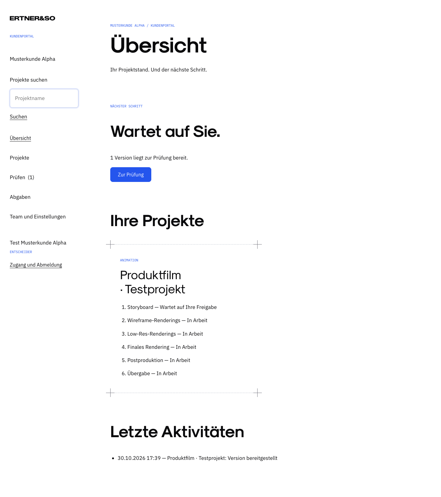
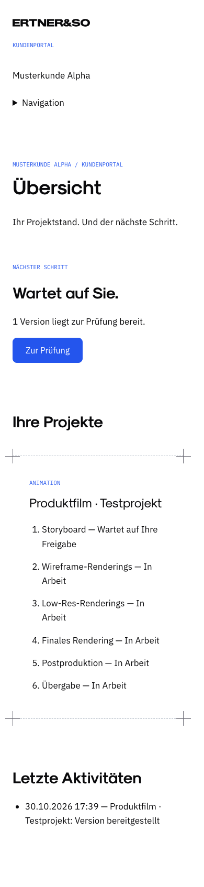
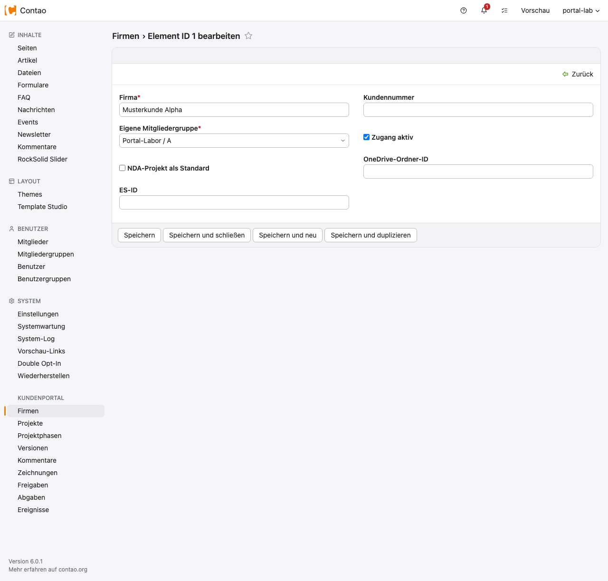

# Geprüfter Grundstand vom 30.10.2026

Geprüft in einer getrennten Contao-6.0.1-Installation mit eigener leerer
MariaDB-Datenbank und künstlichen Firmen. Die Live-Seite wurde nicht verändert.

| Prüfung | Ergebnis |
| --- | --- |
| Firmen, Rollen, IDs und Veröffentlichungsgrenzen | 32 Prüfungen bestanden, Doctrine/SQLite |
| Echter nativer Login, CMS-Element, API und Backend | Bestandteil von 36 bestandenen Browserprüfungen |
| Zwei Firmen und Demo ohne Zuordnung | Gegenseitig ausgeschlossen; auch direkte IDs ergeben keine Fremddaten |
| Desktop 1440 × 1000 und Mobil 390 × 844 | Sichtprüfung, keine horizontalen Überläufe, mobile Navigation nutzbar |
| Privates Caching und Analytics | `no-store` auch bei Fehlern; keine Analytics-Anfragen im Portal |
| Native Abmeldung | Anschließender Portalabruf verweigert |
| CSS-/JS-Prüfungen | Bestanden; Website-Styles unverändert, Portal-Ergänzung getrennt geprüft |
| Container-/Twig-/PHP-Lint | Bestanden im Contao-Labor |

Maschinenlesbare Ergebnisse:
[Berechtigungen](evidence/security-results.json), [Browser](evidence/browser-results.json).

Screenshots enthalten ausschließlich künstliche Testdaten:

## Offene Abnahmen

Keine OneDrive-Anbindung oder Großdatei-Messung, kein Versand echter E-Mails,
keine Kommentar-/Zeichen-/Freigabefunktion und kein realer Kundenpilot.
Die bestehende Oberfläche zeigt für Medien ausdrücklich einen offenen
Einrichtungszustand. Die Tabellen für folgende Pakete sind kein Nachweis einer
bereits implementierten Fachlogik.

Vor der nächsten Freigabestufe benötigt Paket 1 die Microsoft-App und einen
freigegebenen OneDrive-Testordner. Vor Live zusätzlich reguläre Composer-
Installation im endgültigen Image, HTTPS-Konfiguration und erneute Abnahme.
Der Browserzugang zum jetzigen Labor läuft ausschließlich durch einen lokalen
SSH-Tunnel und verwendet keine Live-Zugangsdaten.
